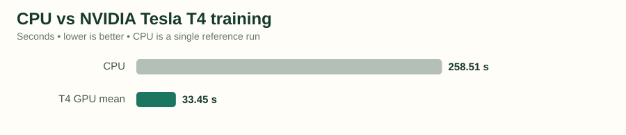
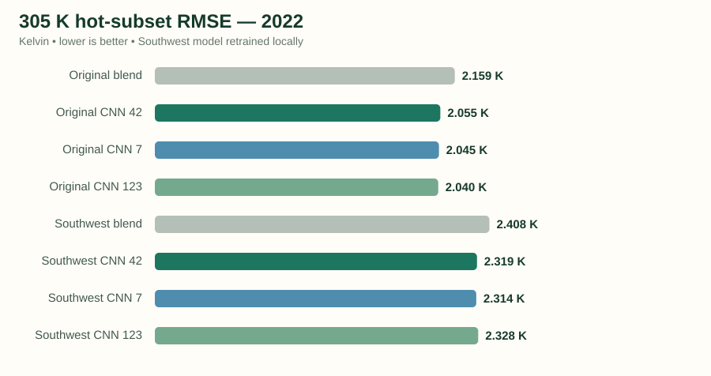
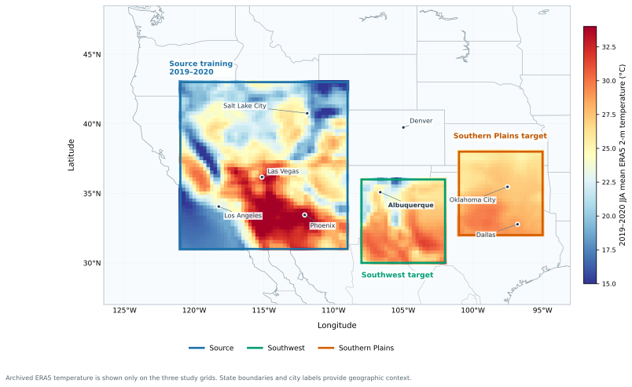
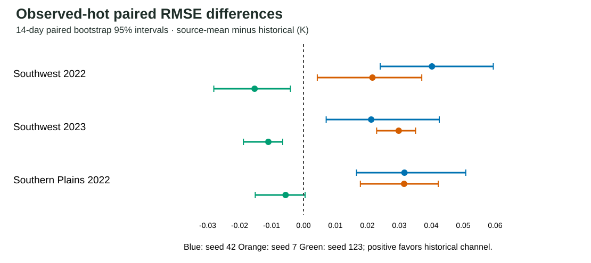

# Western-US-Weather-JAX

**Regional 24-hour temperature hindcasting with JAX — reproducible GPU engineering and a reference × climatology-channel research study.**

[Portfolio case study](https://ys30.github.io/projects/western-us-weather-jax.html) · [Engineering evidence](docs/ENGINEERING_STATUS.md) · [Factorial research results](https://github.com/ys30/Western-US-Weather-JAX/blob/paper-v4-factorial-reanalysis/docs/PAPER_V4_FACTORIAL_RESULTS.md) · [CI runs](../../actions)

This repository has **two related but distinct outcomes**. The engineering track verifies real ERA5 data pipelines, residual CNN training and NVIDIA GPU execution. The research track evaluates how supplying climatological information via a residual reference changes the *marginal* value of a dedicated historical-climatology feature. Their metrics and training protocols should not be conflated.

## 1. Engineering results · JAX, GPU and reproducibility

| Validated component | Evidence |
| --- | --- |
| Implementation | Python/JAX, 24-h lead residual CNN; four temperature frames (42–24 h before verification), UTC-hour features, historical-climatology input, reference correction |
| Real GPU execution | **NVIDIA Tesla T4 (Colab)**; CUDA-backed JAX training and GPU-resident parameters audited |
| Training time | **258.51 s** one CPU reference versus **33.29 s** initial GPU run: **7.76× observed elapsed-time ratio** |
| GPU repeats | Three additional GPU runs averaged **33.45 s**, sample SD **1.92 s** |
| CPU/GPU numerical parity | Both execution paths reported **3.191155 K** test RMSE under the audited matched configuration; repeated GPU runs reproduced this test score |
| Data & CI | Real six-hourly ERA5 acquisition, chronological partitions, model checkpoints, gridded outputs, hashes, automated validation and replay scripts |

The 7.76× result is **not** an end-to-end or statistically paired speedup distribution. The GPU timing and RMSE parity were audited in the earlier engineering protocol, **not** in the later frozen-target four-arm experiment.



**Engineering verification:** [GPU acceptance](docs/GPU_ACCEPTANCE.md) · [GPU execution](docs/GPU_EXECUTION.md) · [repeat benchmark](docs/GPU_REPEAT_BENCHMARK.md) · [technical brief](docs/RECRUITER_EVIDENCE_BRIEF.md) · [engineering status](docs/ENGINEERING_STATUS.md).

**Separate exploratory engineering/modeling results:** The regionally retrained heat-weighted CNNs were compared with region-specific blended references under a *different* protocol. Those results are retained in [engineering status](docs/ENGINEERING_STATUS.md) and [modeling evidence](docs/RECRUITER_EVIDENCE_BRIEF.md), not presented as frozen-weight transfer or as evidence for the factorial channel interaction.



## 2. Research / paper results · Where climatology enters matters

**Manuscript status:** private *Atmospheric Research* submission draft under preparation; **not published or peer reviewed**. The manuscript and submission-only figures are not stored here.

**Research question.** Does the dedicated historical climatology channel contribute equally when the residual reference is (P) 24-h persistence or (B) a validation-selected persistence–climatology blend? For each reference, separately trained CNNs use either a historical target-pretest climatology channel (H) or a source-training mean replacement (S).

- Training: source ERA5 in **2019–2020**, checkpoint selection using **2021** validation; weights frozen in target evaluation.
- Evaluation: **Southwest 2022/2023** and **Southern Plains 2022/2023**, with **10 matched initialization seeds × 4 independently fitted arms**. Each case has **1,460** six-hourly valid times over **25 × 25** ERA5 grid cells.
- Blend: **75% persistence + 25% climatology**, selected on source validation all-case RMSE, not target test performance.
- Outcomes: full-year RMSE and retrospective observed-hot RMSE (verifying ERA5 T2m **≥305 K**).

Define ΔP = RMSE(P,S) − RMSE(P,H); ΔB = RMSE(B,S) − RMSE(B,H); and the interaction **I = ΔB − ΔP**. Positive Δ means that the historical channel reduced error; **negative I** indicates a smaller incremental benefit with the blended reference.

### Ten-seed results from original archived target reports

| Target case | Full-year median I (K) | Full-year negative I | Hot median I (K) | Hot negative I | Hot historical wins: P / B |
| --- | ---: | ---: | ---: | ---: | ---: |
| Southwest 2022 | −0.0795 | 10/10 | −0.0450 | 9/10 | 9/10 · 6/10 |
| Southwest 2023 | −0.0608 | 9/10 | −0.0155 | 6/10 | 7/10 · 6/10 |
| Southern Plains 2022 | −0.1101 | 10/10 | −0.0123 | 6/10 | 8/10 · 6/10 |
| Southern Plains 2023 | −0.0752 | 10/10 | −0.0500 | 9/10 | 9/10 · 7/10 |

The full-year interaction is negative for **39 of 40** seed–case evaluations; observed-hot for **30 of 40**. These are **correlated initialization/case descriptions**, not 40 independent climatic replications or confirmatory significance tests. The smaller blend-column contrast is consistent with overlapping climatology information, but changing the residual anchor also changes the optimization target; this does **not** isolate a physical causal mechanism.

### Absolute hot RMSE · mean across ten CNN seeds (K)

| Case | P + historical CNN | B + source-mean CNN | B + historical CNN | Persistence baseline | Blend baseline |
| --- | ---: | ---: | ---: | ---: | ---: |
| Southwest 2022 | 2.416 | 2.344 | **2.338** | 2.400 | 2.479 |
| Southwest 2023 | 2.113 | 2.075 | **2.072** | 2.077 | 2.222 |
| Southern Plains 2022 | **2.535** | 2.558 | 2.553 | 2.484 | 2.687 |
| Southern Plains 2023 | 2.636 | 2.500 | **2.487** | 2.626 | 2.628 |

The lowest mean CNN arm is **not** universally the blended historical arm (Southern Plains 2022 is an exception). The standalone persistence and blend values are *reference* scores, not CNN arms, and can outperform the CNN in a target case. This table intentionally omits the exploratory ridge MOS because it has not been recalibrated for a like-for-like hot-weighted comparison.

**Verified primary numerical evidence:** [full 80-row annual/hot factorial CSV](https://github.com/ys30/Western-US-Weather-JAX/blob/paper-v4-factorial-reanalysis/results/paper-v4/factorial_10seed_4case_absolute_rmse.csv) · [case summary](https://github.com/ys30/Western-US-Weather-JAX/blob/paper-v4-factorial-reanalysis/results/paper-v4/factorial_case_summary.csv) · [successful 160-report numerical replay](https://github.com/ys30/Western-US-Weather-JAX/actions/runs/42124190191) · [factorial analysis PR](https://github.com/ys30/Western-US-Weather-JAX/pull/1). These data currently live on the research analysis branch until that PR is merged.

### Spatial and independent-observation context

- The archived spatial diagnostics identify hot-sample coverage differences and edge-versus-interior sensitivity. The published public figures below are **earlier three-seed diagnostic subsets**, not new ten-seed spatial estimates.
- Four selected ASOS airport sites (ABQ, ROW, ABI, OKC) over 2022–2023 yield **eight station-years**. At station-observed hot times, the CNN historical arm improves on the shared blend reference in **80/80 seed–station-year point comparisons**, while the concurrent **ERA5 analysis** better matches the station observations. That analysis is a valid-time reanalysis, **not** an issue-time 24-h forecast.
- A separate **six-station-year × three-seed** source-archive audit produced **9 positive and 9 negative annual** matched channel contrasts. This is a subset with a different verification population, not a contradiction or another independent experiment.



*Figure drawn directly from archived 2019–2020 JJA ERA5 source and target NetCDF fields, with paper-matched geographic bounds and a corrected map layout; [successful figure replay](https://github.com/ys30/Western-US-Weather-JAX/actions/runs/42133897861). The original coordinate-only schematic remains available for provenance.*



**Station / spatial evidence:** [ASOS validation protocol](docs/STATION_VALIDATION_ANALYSIS_PROTOCOL.md) · [verified six-station-year CSV](results/additional_asos_southwest2023_plains2022_verified.csv) · [station error decomposition](results/asos_station_error_decomposition_54.csv) · [metric provenance](docs/METRIC_PROVENANCE_AND_FIGURE_AUDIT.md) · [figure register](docs/PUBLIC_FIGURE_EVIDENCE_REGISTER.md).

## 3. Run the engineering workflow / inspect research outputs

```bash
python -m pip install -e '.[test,zarr]' gcsfs
pytest -q
python -m weatherjax --epochs 4 --output outputs/quick-smoke
```

The basic smoke run is not the full ERA5 factorial reproduction. To reproduce the paper tables from downloaded and extracted original Actions archives:

```bash
python scripts/paper_v4_factorial_tables.py --root /path/to/extracted-artifacts --out results/paper-v4
```

Reanalysis source training and target reports were produced in [three-seed factorial run 41714440020](https://github.com/ys30/Western-US-Weather-JAX/actions/runs/41714440020) and [seven-seed extension 41721732092](https://github.com/ys30/Western-US-Weather-JAX/actions/runs/41721732092). Full raw artifacts are **finite-retention**; results CSVs and scripts remain in GitHub, while permanent source/checkpoint/field archival deposit is still outstanding.

## 4. Scope and interpretation

This is a **retrospective ERA5 hindcasting and applied research engineering project**, not operational 24-h weather service validation. A model with frozen source weights can still use pre-test target climatology and recently available target-temperature inputs; “frozen weights” does not mean no target history. The observed-hot subset conditions on verifying temperature and is **not** event detection. Temporal bootstrap intervals describe sampling conditional on a fitted network; seed contrasts do not establish broad climate-population inference. GPU timing, locally retrained temperature models, four-arm frozen CNN comparisons, and station verification are separate protocols.

For the current recruitment-facing overview, see [the two-track portfolio page](https://ys30.github.io/projects/western-us-weather-jax.html).
