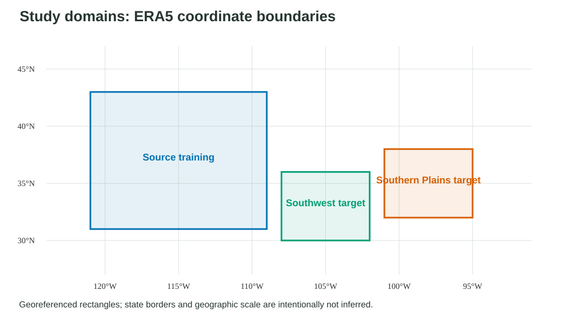
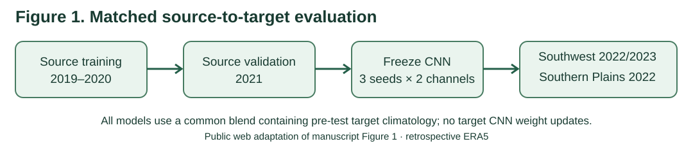
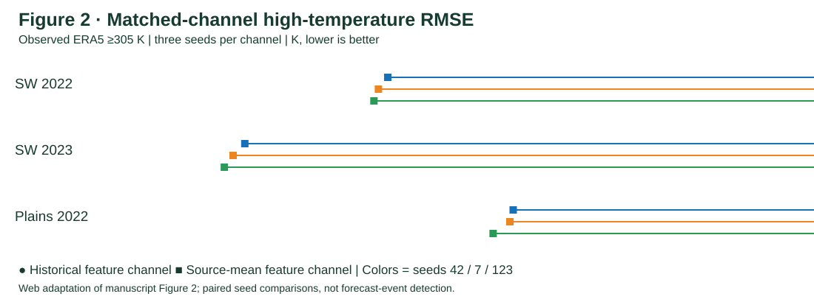
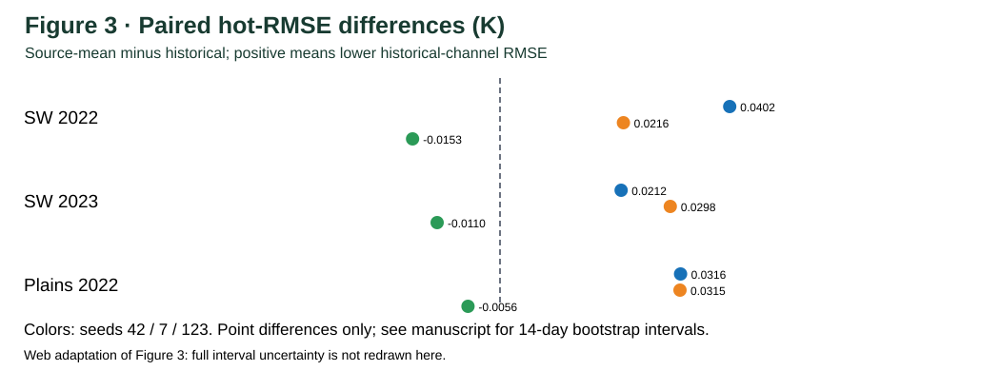

# Western-US-Weather-JAX

**Reproducible ERA5 regional temperature forecasting, JAX CNN engineering, and validated CPU/GPU execution.**

[Portfolio case study](https://ys30.github.io/projects/western-us-weather-jax.html) · [Recruiter evidence brief](docs/RECRUITER_EVIDENCE_BRIEF.md) · [Experiment provenance and full archives](docs/EXPERIMENT_REPRODUCIBILITY_MANIFEST.md) · [GitHub Actions](../../actions)

## At a glance

| Scope | Verified evidence |
| --- | --- |
| Task | **24-hour-ahead** ERA5 2 m temperature regression; four six-hourly inputs, **49 × 49** regional fields |
| Implementation | Python, **JAX**, residual CNNs, chronological train/validation/test splits, spatial climatology, multi-seed evaluation |
| GPU engineering | Real **NVIDIA Tesla T4**: 258.51 s single CPU reference vs 33.29 s initial GPU training (**7.76× descriptive ratio**); three additional GPU runs averaged 33.45 ± 1.92 s |
| Evaluation | Source training 2019–2020, validation 2021; target tests **Southwest 2022**, **Southwest 2023**, **Southern Plains 2022** |
| Statistical sensitivity | Three seeds (42, 7, 123), direct paired moving-block bootstrap (3, 7, 14, 28 days) for matched channel arms |
| Reproducibility | All **three** archival reruns preserved **54 files each**, with **53/53** independently verified file digests per ZIP |

### Why this work is useful

- Built and tested a real-data scientific ML pipeline, not a synthetic weather-model demo.
- Compared CNNs with meaningful persistence/climatology baselines, including cases where the CNN **did not** outperform the comparator.
- Tested model sensitivity to climatology features across a second test year and a geographically distinct target.
- Audited GPU execution, prediction parity, workflow success, model checkpoints, gridded predictions, and SHA256 checksums.

## Expanded ten-seed cross-target findings (research update)

The later research analysis extends the matched-feature comparison beyond the original three-seed showcase. These are **exploratory, retrospective ERA5 results**, not operational heat-warning scores. The primary contrast is source-mean minus historical-channel observed-hot RMSE (K): a positive difference favors the historical feature channel.

| Frozen-source target | Historical channel better | Median paired ΔRMSE (K) | Across-seed IQR (K) |
| --- | ---: | ---: | --- |
| Southwest 2022 | 6/10 seeds | +0.0017 | [-0.0079, +0.0173] |
| Southwest 2023 | 6/10 seeds | +0.0063 | [-0.0109, +0.0175] |
| Southern Plains 2022 | 6/10 seeds | +0.0063 | [-0.0057, +0.0186] |
| Southern Plains 2023 | 7/10 seeds | +0.0096 | [-0.0017, +0.0252] |

[Download the aggregate ten-seed and factorial-interaction CSV](results/ten_seed_four_case_research_summary.csv). This is a curated numeric summary transcribed from the private research draft, not a newly rerun raw-data experiment. These figures describe an across-initialization distribution, **not** a cross-seed confidence interval or proof of general superiority. Earlier three-seed charts below are historical subsets. The full four-case ten-seed data, archives and factorial interaction analyses require experiment-specific provenance; avoid conflating this with the separately regionally retrained experiments.

### Current station validation engineering (not yet station-skill evidence)

An archive-only retrospective validation pipeline has been added: recover matched-channel predictions from saved NPZ truth/error fields, check identical time/truth/reference/grid across arms, bilinearly sample target-valid-time predictions at ASOS coordinates, match station reports by UTC tolerance, then score identical paired samples with calendar-day block bootstrapping. [Analysis protocol](docs/STATION_VALIDATION_ANALYSIS_PROTOCOL.md) · [Archived Southwest 2022 acceptance workflow](.github/workflows/archived-station-spatial-acceptance.yml) · [Station QA workflow](.github/workflows/station-paired-evaluation-qa.yml).

**Acceptance status:** code and workflow definitions are committed, but no new successful end-to-end station-observation workflow, station-level RMSE, or lapse-rate correction has yet been confirmed. The three full model archives documented below remain temporary GitHub Actions artifacts; their integrity checks refer to archival reruns. This is not independent operational forecasting validation.

## Key results — do not mix the two experimental protocols

**Protocol A: heat-weighted, regionally retrained models vs a regional validation-selected persistence–climatology blend.** Lower RMSE is better; observed-hot means verifying ERA5 2 m temperature ≥305 K.

| 2022 test / metric | Blend RMSE (K) | CNN seeds 42 / 7 / 123 RMSE (K) |
| --- | ---: | --- |
| Original region · annual | 2.99462 | 2.98450 / 2.99741 / 2.99243 |
| Original region · observed-hot | 2.15930 | 2.05492 / 2.04506 / 2.03982 |
| Second Southwest region · annual | 3.80252 | 3.77695 / 3.79943 / 3.78322 |
| Second Southwest region · observed-hot | 2.40826 | 2.31885 / 2.31365 / 2.32763 |

All three seeds improved observed-hot RMSE in both target regions under this **local retraining** protocol. Annual improvement was not uniform in the original region. These numbers **do not imply frozen-weight zero-shot transfer**. See [verified runs and GPU audit](docs/RECRUITER_EVIDENCE_BRIEF.md).

**Protocol B: frozen source-trained matched climatology-channel models**, evaluated without target CNN retraining (historical channel vs source-mean channel). Both arms still receive a shared baseline carrying historical climatology. The comparison isolates a **specific feature-channel substitution**, not complete removal of target history.

| Target / metric | Historical feature channel (seeds 42 / 7 / 123) | Source-mean feature channel (same seeds) |
| --- | --- | --- |
| Southwest 2022 · observed-hot RMSE (K) | 2.3474 / 2.3308 / 2.3228 | 2.3876 / 2.3524 / 2.3074 |
| Southwest 2023 · observed-hot RMSE (K) | 2.0932 / 2.0724 / 2.0568 | 2.1144 / 2.1022 / 2.0457 |
| Southern Plains 2022 · observed-hot RMSE (K) | 2.5704 / 2.5645 / 2.5347 | 2.6020 / 2.5960 / 2.5291 |

In each target, historical-channel training helped **two of three** seeds but not the third. No seed-invariant advantage is established. The directly paired time-block CIs are seed- and block-dependent. Source-model transfer is **not** purely zero-history transfer.

- [Southwest 2022 matched evaluation](https://github.com/ys30/Western-US-Weather-JAX/actions/runs/41356348903)
- [Southwest 2023 temporal replication](https://github.com/ys30/Western-US-Weather-JAX/actions/runs/41362832891)
- [Southern Plains 2022 geographical replication](https://github.com/ys30/Western-US-Weather-JAX/actions/runs/41386676606)

### Journal-style study-domain and uncertainty figures



**Study domains:** Source 31–43°N, 121–109°W; Southwest 30–36°N, 108–102°W; Southern Plains 32–38°N, 101–95°W. Region rectangles are drawn from coordinates rather than an unverified illustrated basemap.


The error bars are 14-day paired-bootstrap exploratory 95% intervals; unlike the earlier simplified web graphic they preserve uncertainty bounds. The final submission figures remain private.

## Manuscript-derived visual evidence (public adaptations)

The following accessible SVG figures **adapt the research structure and verified numbers** from the private manuscript; they are **not the original private PNG plates**. The third graphic shows point differences only (the complete 14-day confidence intervals remain in the unpublished manuscript and CI JSON).







Source-mean minus historical **positive** differences favor the historical-feature channel; this occurred in **two of three** seeds for each target. These are retrospective error diagnostics, not heat-alert detection or a demonstration of universal improvement.

## Earlier public engineering charts


The regional and episode figures depict **Protocol A**, not the frozen-weight matched-channel experiments in Protocol B. Truth-defined high-temperature subsets and episodes are retrospective diagnostics, **not forecast event detection or operational warning skill**.

## Reproduce and inspect

```bash
python -m pip install -e '.[test,zarr]' gcsfs
pytest -q
python -m weatherjax --epochs 4
```

The three full-data archives each contain **2 ERA5 NetCDF inputs, 6 checkpoint NPZ, 6 prediction/error NPZ, 12 diagnostics CSV, 24 experiment JSON, one SHA256 manifest and 3 environment/provenance files**.

| Full archival rerun | GitHub Actions | Artifact |
| --- | --- | --- |
| Southwest 2022 | [41400003722](https://github.com/ys30/Western-US-Weather-JAX/actions/runs/41400003722) | `13122165252` |
| Southwest 2023 | [41402185866](https://github.com/ys30/Western-US-Weather-JAX/actions/runs/41402185866) | `13122890221` |
| Southern Plains 2022 | [41402189567](https://github.com/ys30/Western-US-Weather-JAX/actions/runs/41402189567) | `13121977420` |

After downloading any ZIP, run `python scripts/verify_full_archive.py archive.zip`. See [hashes, full run metadata, and retention deadlines](docs/EXPERIMENT_REPRODUCIBILITY_MANIFEST.md). **GitHub artifacts expire on 2027-01-31 UTC; independent permanent storage is not yet established.**

## Scientific and engineering boundaries

- ERA5 reanalysis evaluations are retrospective; this is **not** an operational weather forecasting system or evidence of forecast-time availability.
- The ≥305 K *observed*-hot RMSE metric conditions on the verifying temperature: it is **not event-detection accuracy**.
- The 2021 window was part of model development; multiple validations are **development-stage exploratory evidence**, not pre-registered independent prospective tests.
- The channel substitution retains historical climatology through the common blend; no causal attribution to historical features or general cross-seed superiority is claimed.
- CPU/GPU comparisons use a single earlier CPU timing; the 7.76× figure is a **descriptive elapsed-time ratio**, not a paired GPU speedup distribution.
- The archived inputs and weights belong to **new archival reruns**; the original historical experiment bytes were not proven identical. Dependencies and upstream ARCO snapshots were not pinned immutably.
- Draft manuscripts, submission figures, and private supplementary material are **not published here**.

**Further reading:** [Recruiter brief](docs/RECRUITER_EVIDENCE_BRIEF.md) · [Engineering status](docs/ENGINEERING_STATUS.md) · [Reproducibility manifest](docs/EXPERIMENT_REPRODUCIBILITY_MANIFEST.md) · [Portfolio](https://ys30.github.io/projects/western-us-weather-jax.html).
