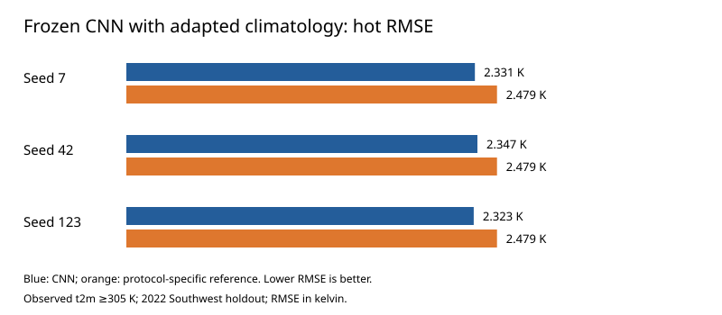
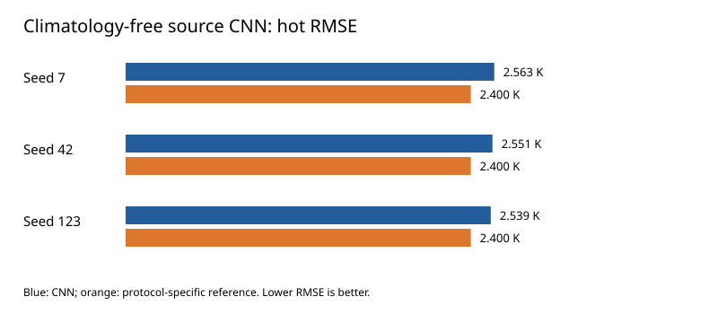
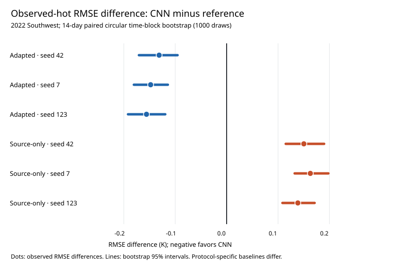

# Working manuscript — research draft (not submitted)

## Title
Cross-Regional Transfer of Temperature Forecasting with JAX Convolutional Networks: Mean Accuracy, Heat-Tail Trade-offs, and Historical Climatology Adaptation

## Abstract (draft)
Regional transfer is an important challenge for data-driven temperature prediction, especially when extreme heat rather than average error determines performance. We evaluated 24-hour-ahead, six-hourly ERA5 2-m temperature prediction with residual JAX convolutional neural networks (CNNs) across geographically disjoint western United States domains. Source-region models were trained on 2019–2020, with 2021 reserved for validation, and evaluated in a separate Southwest domain in 2022. We distinguished frozen CNN weights with target pre-test historical climatology features from source-only models trained and transferred without regional climatology inputs. For frozen climatology-aware CNNs, heat-subset RMSE (observed temperature ≥305 K) was 2.347, 2.331 and 2.323 K across three seeds, compared with 2.479 K for the source-weighted blended reference. Paired 14-day time-block bootstrap 95% intervals for the heat RMSE difference were fully negative across seeds, while annual intervals included zero. Conversely, source-only climatology-free CNNs achieved annual RMSE 4.112–4.098 K versus 4.163 K persistence, but worsened heat-subset RMSE (2.539–2.563 versus 2.400 K), with 14-day bootstrap intervals for heat RMSE differences entirely positive. These contrasting protocols show that improvement in domain-wide mean error need not carry over to observed extreme-heat subsets. They also underscore that the reported climatology-aware transfer is not strict no-target-history zero-shot generalization.

## 1. Introduction — argument map
1. Temperature forecasting models are typically assessed by domain-wide skill; high-impact heat extremes warrant a separately reported metric.
2. Apparent transfer gains must distinguish a model trained again in the target region from a frozen model whose weights are reused.
3. A second distinction concerns local historical climatology as target-domain input information, which may be unavailable in some operational settings.
4. Contribution: a reproducible JAX/ERA5 evaluation that separates target-local retraining, frozen network transfer with historical feature adaptation, and source-only no-climatology transfer; evaluates paired time-block uncertainty; and reports both successful and unfavorable extremes results.

### Related work and scope (source-verified)

ERA5 is an atmospheric reanalysis combining observations and model-based assimilation, and its hourly fields can support retrospective temperature prediction experiments (Hersbach et al., 2020). Recent data-driven global weather systems, including FourCastNet (Pathak et al., 2022) and GraphCast (Lam et al., 2023), demonstrate the potential of learned weather dynamics at much larger physical and computational scales. In contrast, the present experiment is a deliberately compact **regional, single-variable, 24-hour** temperature CNN study: it is **not** an operational global forecast system and its RMSE values are **not directly comparable** to those published for the above models. The JAX implementation uses differentiable array computations and compilation as described in its official software citation (Bradbury et al., 2018). The contribution assessed here is the explicit separation of frozen-weight transfer protocols and their contrasting annual versus truth-conditional heat errors, rather than a claim of overall state-of-the-art forecast skill.

## 2. Methods

### 2.1 Data, geographical domains and temporal partitioning
ERA5 2-m temperature (Kelvin) was sampled every six hours across two nonoverlapping rectangular regions. The original domain was approximately latitude 31–43°N and longitude 121–109°W; the Southwest domain 30–36°N and 108–102°W. The principal cross-region experiments used original-region 2019–2020 data for training, 2021 for validation/epoch selection, and Southwest calendar 2022 for testing. Source training data determined normalization parameters, which were frozen during cross-region inference. Results pertain to these fixed domains and years; they are not random samples of all climates.

### 2.2 Forecast task and baseline
Four available six-hourly temperature frames and forecast-valid-time hour cyclical features were used in convolutional input tensors. The target was 24 hours ahead (four six-hourly steps). Persistence is the temperature field at the valid time minus four six-hourly steps. The climatology-aware variant also included spatial, monthly and UTC-hour historical climatology and a persistence/climatology blend; its blend coefficient was selected using source validation data. A local Southwest-selected blend in the independently retrained protocol is a different baseline and should not be equated with the frozen source-weight reference.

### 2.3 Models and transfer protocols
**A. Target-local retraining:** train Southwest CNNs using its own training period and validation to test model applicability after local adaptation; this is **not frozen transfer**.
**B. Frozen weights, historical feature adaptation:** train on original area; fix validation-selected weights, training normalization, and blend coefficient; construct Southwest spatial climatology from target data dated before 2022; infer 2022 without target model-gradient updates. This involves target historical data and is **not** strict no-target-history transfer.
**C. Source-only architecture:** train the source CNN from the outset without any climatology channels, using recent temperatures, cyclical hour and persistence. Freeze weights and normalization for Southwest 2022 and compare to persistence. Target recent observations are needed as forecast inputs but no target climatology model/statistics are fitted.
**D. Feature substitution sensitivity:** replace climatology features in the already-trained climatology-aware CNN with source training global mean. This induces a feature-distribution shift and is a sensitivity/ablation only, not an equivalent strict-transfer architecture.

Three initializations (seeds 42, 7, 123) were evaluated. Source model selection used original-region validation RMSE, not Southwest 2022 test performance.

### 2.4 Outcomes and uncertainty
Annual RMSE aggregates all test gridcells and valid times. The observed-hot subset restricts scored test points to **truth temperature ≥305 K** (about 31.85°C). Because truth identifies hot points retrospectively, this measures conditional error and **not** heat-event detection. Differences are calculated as CNN minus its **protocol-specific** baseline. Paired circular time-block bootstrap resamples valid times while preserving complete spatial fields, using 1000 draws at blocks of 1, 3, 7 and 14 days. Percentile intervals describe dependence-sensitive uncertainty **within this test domain/year**, not external-spatial replication or multiplicity-adjusted inference.

### 2.5 Time-index and information-availability audit (code-verified; CI-verified)

The dataset constructor defines a target at valid-time index `t` and inputs at `t−7, t−6, t−5, t−4` for a six-hourly series. Therefore the latest observed temperature input is at `t−4` (24 hours before the target), while the oldest is at `t−7` (42 hours before the target). A forecast issued at `t−4` can use these observed frames; the cyclical UTC-hour encoding of the future valid time `t` is known in advance and does not contain observed target temperature. The 24-hour persistence prediction is exactly the temperature at `t−4`.

Validation and held-out test **target** indices do not overlap training targets. The earliest validation/test inputs may belong to the immediately preceding period, which is permitted for a rolling forecast because those input observations predate issue time. Original-area training mean and standard deviation and climatological feature maps are computed before the validation/test cut as specified for each protocol. In the frozen adaptation protocol, target-domain climatology uses the **full 2019–2021 pre-test interval**, including the period corresponding to source validation; this is permitted *historical feature adaptation*, not a no-target-history setting.

The tests in `tests/test_time_audit.py` check lead offset, period boundaries and rejection of missing or irregular six-hour intervals; the guards in `weatherjax/time_audit.py` are called by source-only and climatology-aware training, and target time continuity is checked during frozen inference. [CI verification: unit tests](https://github.com/ys30/Western-US-Weather-JAX/actions/runs/41279255199) and [frozen ERA5 experiment](https://github.com/ys30/Western-US-Weather-JAX/actions/runs/41279255173). The audit validates implemented temporal indexing, not all conceivable upstream dataset provenance issues.

### 2.6 ERA5 source, sampling, and reproducibility provenance

The repository's data-fetch implementation (`scripts/fetch_arco_era5.py`) reads publicly hosted **Google Cloud ARCO ERA5** Zarr data from `gs://gcp-public-data-arco-era5/ar/full_37-1h-0p25deg-chunk-1.zarr-v3`. The source dataset is hourly, gridded at **0.25°** resolution as encoded in the collection name. The script selects the `2m_temperature` variable (with fallbacks for alternative source variable names), converts longitudes to −180°–180° if necessary, crops latitude/longitude bounds, and takes every sixth hourly field with `stride=6`, yielding a six-hourly time series when the source is continuous. It then renames the output variable `t2m`, sets the Kelvin units attribute, validates that values are finite, and writes the selected field as NetCDF. The primary original-region bounds used in this script are 31–43°N, 121–109°W; Southwest downloads use their separate spatial configuration. The explicit UTC cadence is checked by the downstream time-index audit.

This is **an ERA5-based hindcast on reanalysis**, **not a prospective operational forecast**: a reanalysis value at forecast issue time may be produced with retrospective observational assimilation, and cannot automatically be assumed to have been available with operational latency. All predictive-skill statements in this manuscript therefore refer to a **retrospective six-hourly ERA5 temporal holdout**, and do not demonstrate real-time operational forecast performance.

The Google Cloud ARCO mirror provides a copy of ECMWF/Copernicus ERA5 rather than a separate observational product. This fetch-script audit establishes the configured provider, variable and sampling method, but does **not** independently verify immutable source object versions, actual download times or the SHA-256 digests of experiment-specific local NetCDF files. These metadata should be attached to the publication release.

## 3. Results

### 3.1 Frozen network transfer with target historical climatology
In Southwest 2022, the frozen source-weight blended benchmark had annual RMSE 3.799870 K and truth-hot RMSE 2.478656 K. CNN annual RMSE was 3.790533, 3.798109 and 3.794606 K for seeds 42/7/123. CNN truth-hot RMSE was 2.347359, 2.330832 and 2.322750 K, approximately 5.30%, 5.96% and 6.29% below its own blended reference. The 14-day bootstrap 95% intervals for truth-hot CNN-minus-blend were [-0.170609, -0.095481], [-0.180439, -0.114352] and [-0.191826, -0.119412] K. Corresponding annual differences had intervals [-0.024538, 0.006258], [-0.008488, 0.005789] and [-0.019666, 0.009477] K, all spanning zero. All four tested block lengths had negative hot-subset intervals and annual intervals spanning zero.

### 3.2 Source-only no-target-historical-climatology transfer
The Southwest 2022 persistence baseline had annual RMSE 4.162715 K and truth-hot RMSE 2.400407 K. Climatology-free frozen CNNs had annual RMSE 4.112426, 4.098400 and 4.099266 K and truth-hot RMSE 2.550601, 2.563245 and 2.538898 K (seeds 42/7/123). At 14-day blocks, annual CNN-minus-persistence 95% intervals were [-0.067486, -0.031048], [-0.086444, -0.039725] and [-0.085941, -0.038732] K; hot-subset intervals were [0.114932, 0.189626], [0.132285, 0.197894] and [0.108560, 0.171113] K. All four block lengths gave the same qualitative signs. Thus mean accuracy gains coexisted with consistent hot-subset deterioration.

### 3.3 Feature-substitution sensitivity
Replacing the historical climatology channel with source-global-mean constants increased the source-weight blend hot RMSE from 2.478656 to 6.001585 K, and CNN hot RMSE from 2.347359/2.330832/2.322750 to 6.185947/5.924195/5.741222 K. Because both the baseline and learned-input distribution changed, this experiment is **not** a controlled estimate of the isolated causal benefit of climatology or definitive proof about strict spatial transfer.

### 3.4 Figures and comparative interpretation

**Figure 1. Frozen climatology-adapted CNN performance on truth-defined hot test points (Southwest, 2022).** Horizontal bars report held-out observed-hot (t2m ≥305 K) RMSE in kelvin for frozen original-region CNN weights (blue) and the matching **source-validation-selected persistence/climatology blend** (orange), for seeds 7, 42 and 123. The target pre-test historical climatology is available as an input feature in this protocol; target CNN parameters are never updated. Lower is better. This graph is descriptive; the associated 14-day paired-block confidence intervals for CNN-minus-blend are reported in Section 3.1, not displayed on this two-series RMSE bar plot.

**Figure 2. Frozen source-only, climatology-free CNN performance on truth-defined hot test points (Southwest, 2022).** Horizontal bars report hot-subset RMSE in kelvin for three CNN seeds (blue) and **24-hour Persistence** (orange). The CNN architecture is trained from the outset without climatology features and never retrained on Southwest. All three CNN seeds have larger hot RMSE than Persistence, despite lower full-year RMSE, as described in Section 3.2. The 14-day paired-block intervals for CNN-minus-Persistence are reported in Section 3.2.

**Figure archive and reproducibility.** The machine-generated plots `adapted_hot.svg` and `source_only_hot.svg`, and their supporting six-row `comparison.csv`, were successfully produced by the [manuscript figures GitHub Actions run 41281229086](https://github.com/ys30/Western-US-Weather-JAX/actions/runs/41281229086) and packaged in the artifact `paper-figures-artifact-derived`. Generation code is `scripts/manuscript_figures.py`. The workflow downloads the prior successful [frozen adapted transfer artifact](https://github.com/ys30/Western-US-Weather-JAX/actions/runs/41279255173) and [source-only transfer artifact](https://github.com/ys30/Western-US-Weather-JAX/actions/runs/41277714617), selects the **target_history** protocol explicitly, and constructs plot values directly from archived JSON.

**Cross-figure caution:** Figures 1 and 2 use **different protocol-specific baselines** and separately trained feature sets. Juxtaposition demonstrates a qualitative difference in results; it is not a matched randomized experiment proving a climatology-only causal effect. The hot subset is selected using observed truth, not an operational forecast alert. The verified SVGs and unrounded supporting CSV are now also committed under `figures/manuscript/` as durable repository assets.

### 3.5 Original-region 2022 holdout rerun: final CI verification

The latest uninterrupted original-region 2022 full workflow [completed successfully](https://github.com/ys30/Western-US-Weather-JAX/actions/runs/41281229112) and uploaded its [21-file JSON archive](https://github.com/ys30/Western-US-Weather-JAX/actions/runs/41281229112/artifacts/13074566046). For seeds 42/7/123, the validation-selected blended reference had annual RMSE **2.994618 K** and observed-hot RMSE **2.159303 K**. CNN annual RMSE was **2.984499 / 2.997407 / 2.992431 K**, whereas its observed-hot RMSE was **2.054921 / 2.045063 / 2.039816 K**. All three seeds improved the observed-hot subset; seed 7 slightly worsened annual RMSE versus the blend. These original-domain results are separate from the held-out Southwest spatial-transfer protocols.

### Figure 3. Uncertainty in frozen spatial-transfer hot-subset RMSE differences

**Figure 3 caption.** The 95% percentile confidence intervals depict CNN-minus-protocol-reference observed-hot RMSE differences in Southwest 2022. Intervals are based on **1,000 paired circular resamples of 14-day time blocks** and cover seeds 42, 7 and 123. Blue intervals: frozen CNN with Southwest pre-test historical climatology adaptation versus its **source-selected blended reference**; all intervals lie below zero. Orange intervals: separately source-trained climatology-free CNN versus **24-hour persistence**; all intervals lie above zero. The two groups have different features, training and baselines, so juxtaposition is descriptive and not a causal contrast. Source values: [frozen adaptation bootstrap CI #41274429714](https://github.com/ys30/Western-US-Weather-JAX/actions/runs/41274429714) and [source-only bootstrap CI #41277714617](https://github.com/ys30/Western-US-Weather-JAX/actions/runs/41277714617). Exact bounds are archived in `figures/manuscript/transfer_hot_bootstrap_ci.csv`.

## 4. Discussion

### 4.1 What the held-out evaluation establishes

The principal finding is a **metric-dependent transfer trade-off in one defined regional holdout**, not general superiority of a particular CNN. In Southwest 2022, the climatology-adapted frozen-weight protocol reduced RMSE on gridcell-time observations with ERA5 2-m temperature ≥305 K compared with a source-validation-selected persistence/climatology blend. In all three seeds, the 14-day paired-block confidence intervals for the conditional hot RMSE difference were negative, while intervals for the overall difference crossed zero. The source-only no-climatology architecture had the opposite performance pattern against persistence: better domain-wide RMSE and worse truth-hot RMSE for all three seeds. Both favorable and unfavorable outcomes are material to the research conclusion.

### 4.2 Interpretation without unsupported mechanism claims

A plausible explanation is that climatological features encode locally characteristic seasonal and diurnal temperatures, which may help a learned residual model adjust to regional distribution shifts. However, this interpretation is **hypothesis-generating**: the adapted and source-only protocols use different input features, training procedures and comparators. Consequently, their juxtaposition cannot identify the isolated causal contribution of historical climatology. The feature-substitution sensitivity further changes the learned model's input distribution and cannot resolve this confounding.

The original-domain 2022 experiment also showed improved truth-hot RMSE for all three seeds, but its annual advantage was not uniform. Together these results argue for reporting the **distribution of forecasting errors by scientifically relevant condition**, rather than selecting a single summary metric after inspecting the results. Because the hot subset is identified using *observed* ERA5 temperature, the analysis does not estimate detection sensitivity, precision, false-alarm rates or warning lead time.

### 4.3 What would constitute stronger replication

A stronger follow-up design would freeze all model and hyperparameter choices **before** testing another geographically disjoint region or later year; evaluate matched architectures with and without climatological features against a common set of baselines; and quantify hot-condition performance alongside threshold-event detection, calibration and regional skill heterogeneity. A prospective test using information available at forecast issue time would additionally be needed before the term operational forecasting is justified.

## 5. Limitations and reproducibility qualifications

First, the independent spatial holdout is restricted to the Southwest domain in 2022. Three random seeds test optimization variability, not sampling variability across regions or years. Second, although the code separates chronological training/validation/test targets, historical exploration of the domain, feature design and hyperparameters may still introduce *researcher-selection bias*. The held-out label should be understood as chronological model evaluation, not a fully preregistered external replication.

Third, the reported 95% percentile intervals are generated by paired circular block resampling of test times and intact spatial fields. Their interpretation is conditional on the region/year and on the model choices already made; the intervals do not adjust for multiple seeds, evaluated models, or alternative thresholds. Blocks up to 14 days probe a range of temporal dependence assumptions but do not establish the correct asymptotic sampling distribution for spatial climate extremes. No general population-level coverage claim is made.

Fourth, 305 K is a fixed **retrospective conditional scoring threshold** rather than a documented human-health warning criterion. The subset uses the observed target to determine inclusion; consequently it does not measure actionable heat alerts. Fifth, the adapted model uses Southwest **2019–2021** temperature records to construct target historical climatology. It is frozen with respect to learned CNN parameters, but is not strict no-target-history zero-shot transfer.

Sixth, the ERA5 inputs are retrospective reanalysis fields from the Google Cloud ARCO ERA5 mirror. Their timestamps precede targets in the constructed supervised examples, but archived reanalysis products may incorporate observations unavailable in real time at the nominal forecast-issue time. The experiments are therefore **reanalysis-based hindcasts**, not verified operational 24-hour forecasts. Exact source-object versions, local-file digests and environment locks remain to be archived for a release.

Finally, the comparison is based on a single meteorological variable, relatively small geographic rectangles, and relatively simple convolutional architectures. It neither benchmarks modern global forecast systems fairly nor establishes superior computational efficiency across hardware. The primary contribution is a reproducible, transparently qualified contrast between distinct transfer configurations and their mean-versus-heat-conditional error behavior.

## Data and code availability
Code and reproducible GitHub Actions: https://github.com/ys30/Western-US-Weather-JAX . ERA5 data access is automated in workflow scripts; the repository does not imply redistribution of ERA5 as owned data.

## Evidence ledger
- Frozen transfer numerics: https://github.com/ys30/Western-US-Weather-JAX/actions/runs/41273562903
- Frozen transfer paired bootstrap: https://github.com/ys30/Western-US-Weather-JAX/actions/runs/41274429714
- Source-only frozen spatial transfer: https://github.com/ys30/Western-US-Weather-JAX/actions/runs/41276916469
- Source-only paired bootstrap: https://github.com/ys30/Western-US-Weather-JAX/actions/runs/41277714617
- Feature-substitution sensitivity: https://github.com/ys30/Western-US-Weather-JAX/actions/runs/41275083685

**Editorial note:** This remains an evidence-based draft, not a submission-ready article. Bibliographic anchors were added; authorship, dataset citation/terms, model-development chronology and venue-specific claims still require final checks. The original-domain 2022 full rerun has now succeeded in GitHub Actions run 41281229112; see its archived evidence.

## References (verified bibliographic anchors; journal style pending)

1. Hersbach, H., Bell, B., Berrisford, P., et al. (2020). The ERA5 global reanalysis. *Quarterly Journal of the Royal Meteorological Society*, **146**, 1999–2049. https://doi.org/10.1002/qj.3803
2. Pathak, J., Subramanian, S., Harrington, P., et al. (2022). FourCastNet: A global data-driven high-resolution weather model using adaptive Fourier neural operators. *arXiv* preprint 2202.11214. https://arxiv.org/abs/2202.11214
3. Lam, R., Sanchez-Gonzalez, A., Willson, M., et al. (2023). Learning skillful medium-range global weather forecasting. *Science*, **382**(6677), 1416–1421. https://doi.org/10.1126/science.adi2336
4. Bradbury, J., Frostig, R., Hawkins, P., et al. (2018). JAX: Composable transformations of Python+NumPy programs [Software]. https://github.com/jax-ml/jax/blob/main/CITATION.bib

**ERA5 dataset credit pending final metadata and terms verification.** The archived fetch script uses the Google Cloud ARCO ERA5 Zarr mirror (see Section 2.6), not a direct Copernicus CDS API download. The ERA5 *paper* citation does not substitute for the dataset-specific citation and licensing/attribution for the actual mirror. Confirm the precise collection reference, retrieval and processing information, and the applicable attribution; use [Copernicus CDS guidance](https://confluence.ecmwf.int/spaces/CKB/pages/197704114/) and the [ECMWF attribution guidance](https://confluence.ecmwf.int/pages/viewpage.action?pageId=673321178). Do not assert a retrieval method without auditing the repository's fetch script.

## Appendix A. Cross-protocol result registry (verified)

| Protocol | Training domain | Target adaptation | Comparator | CNN annual RMSE K (42 / 7 / 123) | CNN truth-hot RMSE K (42 / 7 / 123) | Comparator annual / hot K |
| --- | --- | --- | --- | --- | --- | --- |
| Frozen climate-aware | Original | Southwest pre-2022 history as climatology features; no target gradient updates | Source-selected persistence/climatology blend | 3.7905 / 3.7981 / 3.7946 | 2.3474 / 2.3308 / 2.3228 | 3.7999 / 2.4787 |
| Frozen source-only | Original | No target climatology; recent forecast-time observations only | 24-h persistence | 4.1124 / 4.0984 / 4.0993 | 2.5506 / 2.5632 / 2.5389 | 4.1627 / 2.4004 |

**Comparability warning:** model architectures and comparator definitions differ, so subtracting raw errors across these two rows is not a controlled effect estimate. The separate *target-local retraining* result is not included in this frozen-model table.

## Appendix B. Pre-submission verification queue

1. **Completed:** Original-area 2022 full-run successfully completed in [CI #41281229112](https://github.com/ys30/Western-US-Weather-JAX/actions/runs/41281229112), artifact `independent-2022-era5-metrics` (21 JSON). Previous cancelled runs were superseded, not statistical failures.
2. **Partly complete:** Source endpoint, ARCO ERA5 provider, variable, native grid and six-hourly selection verified in code. Still record retrieval timestamp, local-file SHA-256 hashes and dependency lockfile in a fixed release.
3. **Completed:** The figure-generation workflow successfully regenerated two hot-RMSE plots and a comparison CSV from archived successful JSON in run 41281229086. **Next:** publication-layout review and adding committed figure copies or permanent release assets.
4. Confirm paper's model-selection/development chronology and evaluate external region/year replication before strong independent-generalization claims.
5. **In progress:** Four core scientific/software references have been verified and inserted; finalize journal reference style, ERA5 dataset-specific credit and licence after checking actual data provenance.

